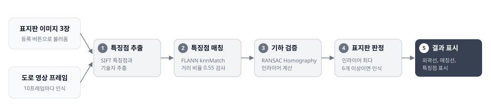

# Computer Vision Basics

『컴퓨터 비전과 딥러닝』(오일석, 한빛아카데미, 2023) 교재 순서에 따라 이론을 정리하고, 
SIFT 특징점 매칭으로 도로 표지판 인식 프로그램을 만든 저장소입니다.

## 기술 스택

---

## 📁 이론 정리

1. [컨볼루션 · 전처리 · 모폴로지](./theory/01_convolution_preprocessing_morphology.md)
2. [에지 검출 · 영역 분할 · 미분 필터](./theory/02_edge_segmentation_derivative.md)
3. [딥러닝 기초 — 퍼셉트론, 손실 함수, 역전파, 최적화](./theory/03_deep_learning_fundamentals.md)

---

## 🚀 실습 — 어린이 보호구역 표지판 인식 (SIFT)

도로 영상에서 어린이 보호구역 · 속도 30 제한 · 횡단보도 표지판을 SIFT 특징점 매칭으로 찾아, 종류와 위치를 표시하는 PyQt5 프로그램입니다.

[표지판 인식 프로젝트 상세보기 →](./sift_sign_recognition/)
