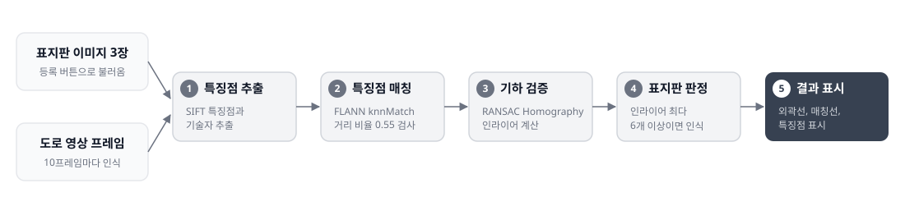

# 어린이 보호구역 표지판 인식 (SIFT)

## 핵심 역량

- 영상에서 기준 이미지를 찾아 종류와 위치를 판별하는 인식 파이프라인 구현
- 특징점 매칭 결과를 RANSAC Homography로 검증해 오매칭을 걸러내는 판정 로직 설계
- 매칭선과 외곽선으로 인식 결과를 시각화해 검증 가능한 형태로 제시
- OpenCV와 PyQt5로 영상 처리 결과를 확인하는 데스크톱 프로그램 개발

## 개요

- 영상 속 어린이 보호구역, 속도 30 제한, 횡단보도 표지판을 SIFT 특징점 매칭으로 인식하고 위치를 표시하는 PyQt5 프로그램
- 입력: 영상 파일 (mp4, avi, mov)
- 사용 라이브러리: Python, OpenCV, NumPy, PyQt5

## 동작 흐름

- 특징점: 영상에서 눈에 띄는 지점의 위치 (코너 등)
- 기술자: 특징점 주변의 밝기 변화 방향을 128개 숫자로 나타낸 벡터, 두 이미지의 특징점을 비교할 때 사용
- 단계별 판정 기준은 아래 인식 과정에 정리

## 인식 과정

1. 등록한 표지판 이미지 3장을 그레이스케일로 변환하고 SIFT 특징점과 기술자 추출
2. 영상 프레임에서 같은 방식으로 특징점과 기술자 추출
3. FLANN 기반 knnMatch(k=2) 수행 후 거리 비율 0.55 미만의 매칭만 선별
4. 좋은 매칭이 8개 이상인 표지판만 후보로 선정
5. RANSAC Homography(허용 오차 5.0)로 인라이어 계산
6. 인라이어가 가장 많고 6개 이상이면 인식 성공으로 판정
7. perspectiveTransform으로 표지판 외곽선 계산, cv.line과 cv.circle로 외곽선과 매칭선, 특징점을 직접 그려 표시 (화면 축소 비율에 맞춰 선 두께 보정)

## 사용 순서

1. 표지판 등록: 표지판 이미지 3장 불러오기, 특징점 추출
2. 도로 영상 불러오기: 영상 파일 선택
3. 인식 시작: 30ms 주기로 프레임 갱신, 10프레임마다 인식 수행

## 주요 파라미터

| 이름 | 값 | 의미 |
|---|---|---|
| RATIO_T | 0.55 | 거리 비율 검사 기준 |
| MIN_GOOD | 8 | 후보 선정에 필요한 최소 좋은 매칭 수 |
| MIN_INLIERS | 6 | 인식 성공에 필요한 최소 인라이어 수 |
| RANSAC 허용 오차 | 5.0 | findHomography의 재투영 오차 기준 |
| recognition_interval | 10 | 인식을 수행하는 프레임 간격 |

## 폴더 구성

- `CV_PRG_objecttracking.py`: 프로그램 코드
- `schoolzone.png`: 어린이 보호구역 표지판
- `30limit.png`: 속도 30 제한 표지판
- `crosswalk.png`: 횡단보도 표지판
- `pipeline.svg`: 동작 흐름 도식

## 실행 방법

- 라이브러리 설치: `pip install opencv-python numpy PyQt5`
- 실행: 이 폴더에서 `python CV_PRG_objecttracking.py`
- 도로 영상 파일은 저장소에 포함되어 있지 않음, 실행 후 영상 파일을 직접 선택

## 관련 이론

- 가우시안 블러를 이용한 크기별 특징점 검출: [컨볼루션과 전처리](../theory/01_convolution_preprocessing_morphology.md)
- 밝기 변화 방향(기울기) 기반 기술자 계산: [에지와 미분 필터](../theory/02_edge_segmentation_derivative.md)